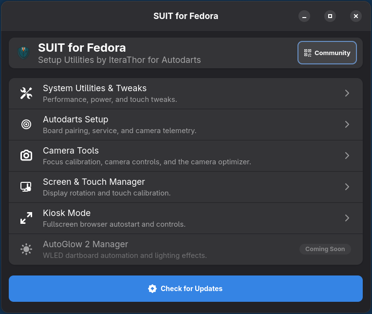
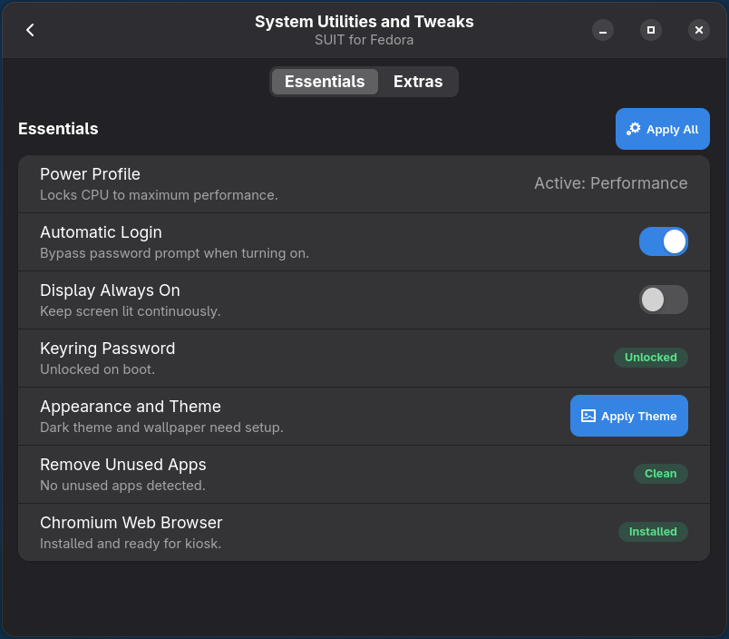
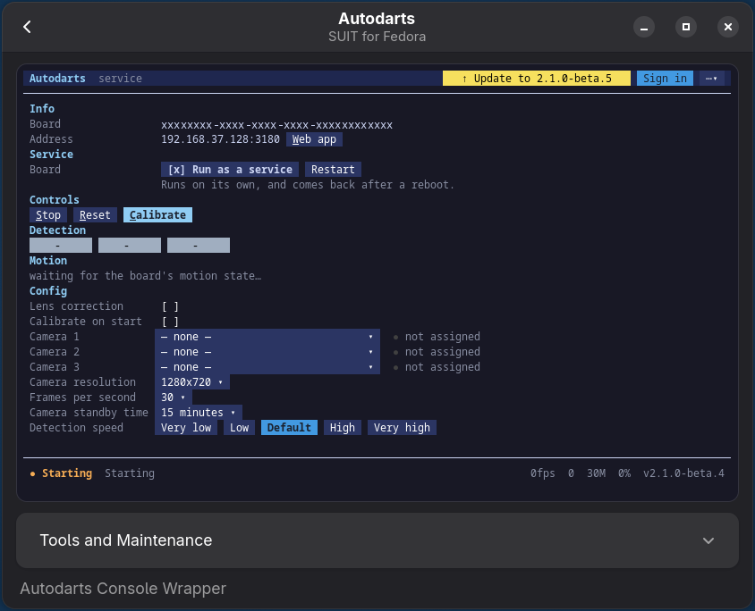
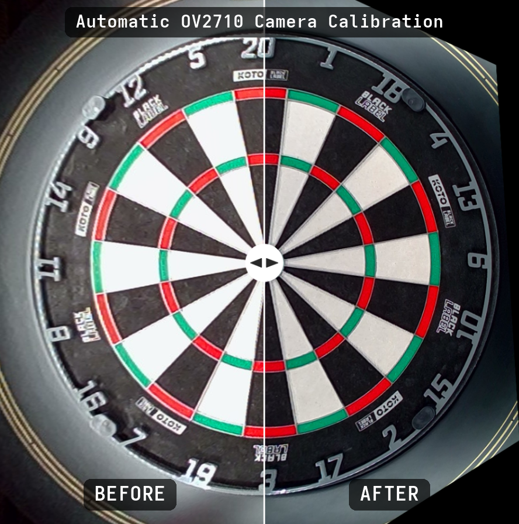
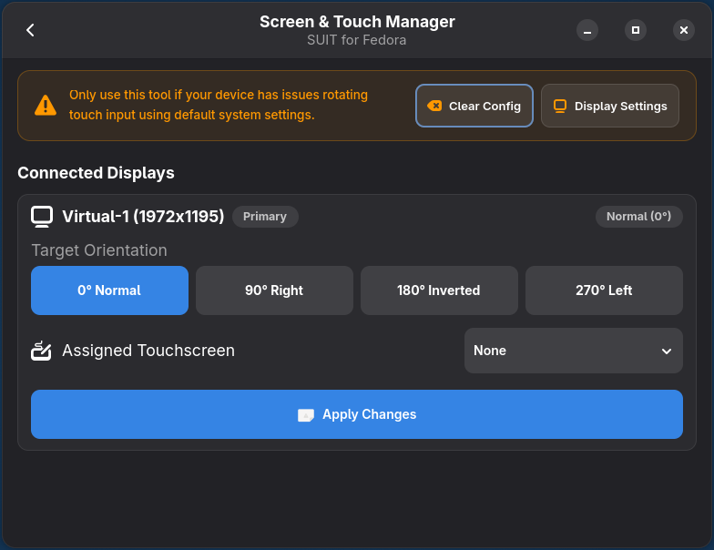
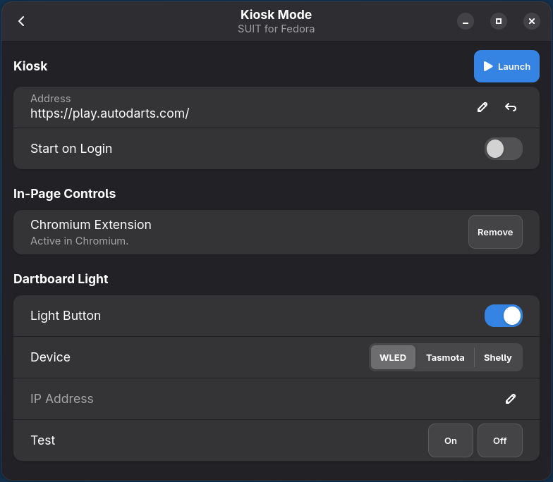

<div align="center">
  
  <h1>SUIT for Fedora</h1>
  <p><strong>Setup Utilities by IteraThor for Autodarts on Fedora Linux</strong></p>
</div>

---

## Quick Install

To install SUIT, copy and run this single command in your terminal:

```bash
git clone https://github.com/IteraThor/SUIT.git && cd SUIT && chmod +x install.sh && ./install.sh
```

Launch **SUIT for Fedora** directly from your application menu or Dash favorites once installed.

---

## Uninstalling SUIT for Fedora

To remove SUIT for Fedora, its background services, autostarts, and desktop launchers:

```bash
cd SUIT && ./uninstall.sh
```
*(Optional: pass `./uninstall.sh --purge` to also delete saved camera profiles and display configurations).*

---

## Upgrading from Legacy SUIT (Ubuntu / Tkinter Edition)

If you are migrating from an older installation of SUIT (Tkinter / Ubuntu edition), run this one-line command to remove legacy background services (`suit-killswitch.service`, `autoglow.service`) and old Ubuntu launchers:

```bash
curl -sSL https://raw.githubusercontent.com/IteraThor/SUIT/main/uninstall_legacy.sh | bash
```

---

## Features & Modes

### 1. Main Dashboard
Modern Libadwaita touch menu providing rapid access to all system tools and live status.

<div align="center">
  
</div>

* Large 44px+ touch targets optimized for touchscreens.
* Quick access to community resources, Discord, and 3D print models.
* Integrated one-click update checker.

---

### 2. System Utilities & Touchscreen Tweaks
One-click performance, display, and desktop optimizations for dartboard machines. The **Essentials** tab holds everything *Apply All* sets up; the **Extras** tab has the optional tweaks (touchscreen tweaks, minimal desktop, Fast Boot, hardware overlay, advanced tools).

<div align="center">
  
</div>

* **Touchscreen Tweaks**: Enlarges GNOME top bar to 54px, expands button touch padding, enables On-Screen Keyboard (OSK), and restores window Minimize/Maximize buttons across Chromium and desktop apps.
* **Minimal Desktop**: One switch for a cleaner rig desktop: a dock with your favorite and running apps sits on the wallpaper (windows simply cover it), and top bar icons and quick settings a dart machine never needs (accessibility, microphone, power mode, night light, dark style, do not disturb) are hidden. When AutoGlow 2 is installed, an **Autoglow 2** button next to Wi-Fi opens its web interface.
* **Performance Profile**: Locks CPU governors to high-performance mode to minimize dart detection latency.
* **Display Keepalive & Auto-Login**: Bypasses screen blanking, sleep timeouts, and login password prompts.

---

### 3. Autodarts Setup
The official Autodarts v2 console, embedded and sized to fit, plus install and maintenance tools.

<div align="center">
  
</div>

* Everything from the Autodarts console in one page: board info and sign-in, run as a service, start / stop / reset / calibrate, cameras, resolution, FPS, standby time and detection speed.
* The console scales its font to the window, so every section is visible without scrolling.
* **Tools and Maintenance**: restart the console, and reinstall or uninstall Autodarts.

---

### 4. Camera Focus Tool
Optical calibration wizard to achieve razor-sharp focus across all 3 Autodarts cameras.

* **Sweet-Spot HUD**: Projects a green target reticle directly onto the furthest double ring wire.
* **2.5x Magnifier Lens**: Live zoomed view centered on the sweet spot for fine optical lens adjustments.
* **Sharpness Score Meter**: Normalized 0–100 score gauge with real-time peak tracking and focus trend indicators.
* **Audio Tone Guidance**: Modulates pitch dynamically as focus improves, allowing you to focus lenses while standing at the board without looking at the screen.

---

### 5. Camera Optimizer (HBV OV2710)
One-click image calibration for HBV OV2710 cameras (USB ID `0bdc:2710`), found under **Camera Tools**.

* **One click**: stops Autodarts, calibrates every camera against the empty board, matches them, and starts Autodarts again (about 2 minutes).
* **Hidden camera controls**: longest flicker-free exposure at 1× sensor gain, matched digital gain, low sharpening, and a high MJPEG quality picked by a bandwidth check across all cameras. About twice as visible darts in Autodarts' difference image on the reference rig.
* **Stays applied**: the `suit-camera-keeper` user service writes the settings before Autodarts opens the cameras and re-applies them after restarts and standby. Nothing is flashed; settings live in camera RAM.
* **Fine-tuning** afterwards on the **Camera Controls** page, with "Reset to calibrated" and a brightness check.
* **Before and after** comparison per camera, and **Restore original settings** to undo everything.

Only cameras with the HBV USB ID and a verified firmware build are touched; you confirm once that you use HBV OV2710 cameras. Profiles live in `~/.config/hbvcal`.

<p align="center">
  
</p>

---

### 6. Camera Controls
Live view and every setting of each camera, for any UVC camera, found under **Camera Tools**.

* **Every control** grouped by Exposure / Tone / Detail / Color / Stream; on confirmed HBV OV2710 cameras also JPEG quality and sensor gain.
* **Keep these settings**: per camera, re-applied by the `suit-camera-keeper` service before Autodarts opens the cameras and after every restart or standby.
* **Presets**: save the settings of all cameras under a name (e.g. day / evening light) and load them in one tap.
* **Live view** that never takes a camera away from Autodarts: while Autodarts runs, it shows Autodarts' own picture.

---

### 7. Screen & Touch Manager
Wayland display orientation and touch coordinate matrix calibration.

<div align="center">
  
</div>

* Rotate displays seamlessly between 0° Normal, 90° Right, 180° Inverted, and 270° Left.
* Automatic touch matrix calibration (`LIBINPUT_CALIBRATION_MATRIX`) via udev rules to align touch input with rotated screens.
* Discovers connected displays and touchscreen controllers automatically.

---

### 8. Fullscreen Kiosk Mode
Run Autodarts as a dedicated full-screen appliance with customized browser controls.

<div align="center">
  
</div>

* Boots Chromium directly into fullscreen mode without desktop distractions, optionally on login.
* Built-in Chromium extension adding Power, Restart, Exit and Board Configuration buttons directly into the Autodarts header.
* Optional dartboard light button for WLED, Tasmota or Shelly devices, with an On / Off test.
